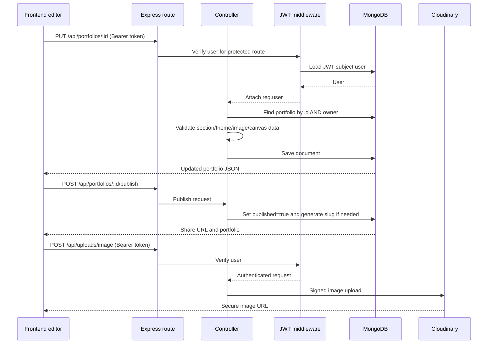

# Pagecraft backend

The backend is a Node.js and Express API backed by MongoDB/Mongoose. It handles accounts and sessions, portfolio ownership and validation, saves and publishing, public portfolio reads and visit counting, and authenticated image uploads to Cloudinary. The React frontend is documented in [`../Frontend/README.md`](../Frontend/README.md); the repository overview is in [`../README.md`](../README.md).

## Run the API

Requirements: Node.js/npm, a MongoDB instance, and (for uploaded images) a Cloudinary account.

From this directory:

```powershell
Copy-Item .env.example .env
# Edit .env and set at least MONGO_URI and a private JWT_SECRET.
npm install
npm run dev
```

The API listens on `http://localhost:5000` by default. `npm start` starts without nodemon. The frontend Vite server is a separate process. The API retries MongoDB connection every five seconds; database-dependent auth and portfolio routes return `503` until it is connected. `GET /health` reports API and database connection status.

## Environment variables

| Variable | Required | Purpose |
| --- | --- | --- |
| `PORT` | No | HTTP port; defaults to `5000`. |
| `MONGO_URI` | Yes | MongoDB connection string. Local default example: `mongodb://127.0.0.1:27017/pagecraft`. |
| `JWT_SECRET` | Yes | Private signing key for bearer tokens. Use a long random secret. |
| `JWT_EXPIRES_IN` | No | Token lifetime accepted by `jsonwebtoken`; defaults to `7d`. |
| `CLIENT_URL` | Yes for deployed frontend | Allowed frontend origin(s), comma-separated. Defaults to `http://localhost:5173`; non-production localhost ports are allowed automatically. |
| `PUBLIC_CLIENT_URL` | No | Public site origin used when forming a published URL; otherwise the first `CLIENT_URL` is used. |
| `GOOGLE_CLIENT_ID` | No | Google OAuth audience/client ID; needed for Google sign-in. |
| `EMAIL_USER`, `EMAIL_PASS` | No | SMTP credentials used by Nodemailer for welcome/login/password-reset mail. |
| `CLOUDINARY_CLOUD_NAME`, `CLOUDINARY_API_KEY`, `CLOUDINARY_API_SECRET` | No for core API; required for image upload | Server-only credentials used to sign and upload images. |

Keep `.env` private and out of source control. Uploads return a clear service-unavailable response when Cloudinary is not configured. Email notices are optional; password-reset requests can be issued, but delivery requires valid SMTP configuration.

## System architecture

```mermaid
flowchart TB
  Browser[React + Vite frontend]
  subgraph API[Express API]
    App[server.js: CORS, JSON parser, health]
    AuthRoutes[/api/auth]
    PortfolioRoutes[/api/portfolios]
    UploadRoutes[/api/uploads]
    AuthController[authController]
    PortfolioController[portfolioController]
    UploadController[uploadController]
    AuthMiddleware[requireAuth: verify JWT and load user]
  end
  Mongo[(MongoDB: User, Portfolio, PortfolioVisitor)]
  Cloud[(Cloudinary: image files)]
  SMTP[SMTP via Nodemailer]
  Browser -->|JSON; protected calls carry Bearer token| App
  App --> AuthRoutes --> AuthController
  App --> PortfolioRoutes --> PortfolioController
  App --> UploadRoutes --> UploadController
  AuthRoutes --> AuthMiddleware
  PortfolioRoutes --> AuthMiddleware
  UploadRoutes --> AuthMiddleware
  AuthController --> Mongo
  PortfolioController --> Mongo
  UploadController --> Cloud
  AuthController --> SMTP
```

`server.js` loads environment variables, applies credentialed CORS and a 12 MB JSON parser, starts the MongoDB retry loop, mounts routes, exposes `/` and `/health`, and installs a fallback error response. Auth and portfolio route groups check database availability. Uploads also need the database for the user lookup performed by JWT middleware. Protected routes authenticate with `requireAuth`; public portfolio GET and view-recording endpoints are intentionally registered before that middleware.

## Request lifecycle

1. The frontend sends JSON to the API. Protected calls include `Authorization: Bearer <JWT>`.
2. Express applies CORS/body parsing and routes the request to a controller.
3. For protected endpoints, `requireAuth` verifies the JWT, loads the user, and attaches it to `req.user`.
4. Controllers validate/sanitize input and apply ownership filters for portfolio reads and writes.
5. Mongoose persists and queries MongoDB. The image upload controller sends image data to Cloudinary using server-only credentials.
6. The API returns JSON; the frontend updates the dashboard, editor, or public renderer.

The API is on port 5000 by default. Vite uses `http://localhost:5000` as its default API URL, overridable by `VITE_API_URL` in the frontend environment.

## API routes

All routes below are prefixed with `/api`. Protected routes require a bearer JWT unless marked **Public**.

### Authentication: `/auth`

| Method | Path | Access | Purpose |
| --- | --- | --- | --- |
| `POST` | `/signup` | Public | Create a local user and return a session/user result. |
| `POST` | `/login` | Public | Verify email/password and issue a JWT. |
| `POST` | `/google` | Public | Verify a Google credential and issue a JWT. |
| `POST` | `/forgot-password` | Public | Request a password reset message. |
| `POST` | `/reset-password` | Public | Validate reset token and change password. |
| `GET` | `/profile` | Protected | Return the signed-in user's public profile fields. |
| `PUT` | `/profile` | Protected | Update display name and public URL name. |

Local passwords are hashed with bcryptjs. JWTs are signed using `JWT_SECRET`, expire according to `JWT_EXPIRES_IN`, and contain the user ID/email. Google credentials are verified against `GOOGLE_CLIENT_ID`. Email delivery uses Nodemailer helpers and is optional configuration.

### Portfolios: `/portfolios`

| Method | Path | Access | Purpose |
| --- | --- | --- | --- |
| `GET` | `/` | Protected | List the current user's portfolios, most recently updated first. |
| `POST` | `/` | Protected | Create a portfolio from template/content/theme data. |
| `GET` | `/:id` | Protected | Read one portfolio owned by the current user. |
| `PUT` | `/:id` | Protected | Update supplied portfolio fields after validation. |
| `DELETE` | `/:id` | Protected | Delete an owned portfolio. |
| `POST` | `/:id/duplicate` | Protected | Create an editable copy of an owned portfolio. |
| `POST` | `/:id/publish` | Protected | Publish or unpublish and return the share URL. |
| `GET` | `/public/:slug` | Public | Read a published portfolio, including its owner display name. |
| `POST` | `/public/:slug/view` | Public | Record a qualified public view. |

The public routes are declared before `router.use(requireAuth)` so they remain accessible without a session. Slugs are generated on publish using the owner's chosen public name (or name) plus a short portfolio-specific suffix. The API keeps prior slugs available while a portfolio remains published. Publishing does not copy or snapshot the content: public reads render the portfolio's latest saved data.

### Upload: `/uploads`

| Method | Path | Access | Purpose |
| --- | --- | --- | --- |
| `POST` | `/image` | Protected | Validate an image data URL, sign a Cloudinary upload, and return its secure URL. |

The backend keeps Cloudinary credentials out of the browser. The upload endpoint accepts supported image data, limits each file to 5 MB, uploads to Cloudinary, and returns a URL that the frontend stores in the portfolio content. Configure all three Cloudinary variables to enable it.

## Portfolio data model

`models/Portfolio.js` defines the document. Every portfolio has an `owner` reference, `title`, `templateId`, timestamps, and the following main fields:

| Field | Meaning |
| --- | --- |
| `sections` | Ordered page sections, each with stable string ID, section type, title/body, image/gallery content, crop settings, and optional positioning/font/link data. |
| `canvasElements` | Optional text/image/shape/icon elements with coordinates, dimensions, styling, and optional section association. |
| `theme` | Accent/background/section colors, font, layout, and text scale. |
| `templateContent` | Editable text overrides for the supplied static iPortfolio template. |
| `templateImages`, `templateImageSettings` | Image overrides and crop settings for that legacy template. |
| `slug`, `previousSlugs` | Current and prior public URL keys. |
| `published` | Whether public endpoints can return the portfolio. |
| `visits` | Qualified public visit counter. |

`models/User.js` stores identity, auth provider, password hash for local accounts, optional public slug, and password-reset state. `models/PortfolioVisitor.js` stores a hashed anonymous browser ID per portfolio to rate-limit view counting; raw visitor IDs are not stored in that collection.

## Save and publish flow



For public portfolio visits, the frontend waits until the page is visible before posting a view event. The API excludes the owner, hashes the provided anonymous visitor identifier, and counts at most one visit per portfolio/browser ID per 24 hours. Visitor records expire after 90 days.

## Source map

| Path | Responsibility |
| --- | --- |
| `server.js` | Express setup, middleware, database gating, route mounts, health and error handling. |
| `config/db.js` | MongoDB connection with retry loop. |
| `routes/` | HTTP paths and public/protected route ordering. |
| `middleware/requireAuth.js` | JWT verification and request user lookup. |
| `controllers/authController.js` | Signup/login/Google/profile/password-reset behavior. |
| `controllers/portfolioController.js` | Portfolio CRUD, data cleaning, publication, public reads and visit counts. |
| `controllers/uploadController.js` | Authenticated image validation and Cloudinary upload. |
| `models/` | User, portfolio and visitor Mongoose schemas. |
| `utils/portfolioSlug.js` | Safe public slug generation. |
| `utils/sendEmail.js`, `utils/emailTemplates.js` | Optional email transport and messages. |

## Operational notes

- `GET /health` returns HTTP `200` when MongoDB is connected and `503` while the API is retrying its connection.
- The API JSON parser allows requests up to 12 MB. Image uploads have smaller image-specific limits.
- Development CORS allows localhost and 127.0.0.1 on arbitrary ports. In production, set exact frontend origins in `CLIENT_URL`; use `PUBLIC_CLIENT_URL` if the public-link origin differs.
- The API fallback error handler logs the stack server-side and sends a generic `500` message to clients.
- Public pages are delivered by the frontend application; the API only supplies published portfolio JSON.
- The iPortfolio template's included contact form targets its original PHP endpoint. The Pagecraft API does not process that form.
